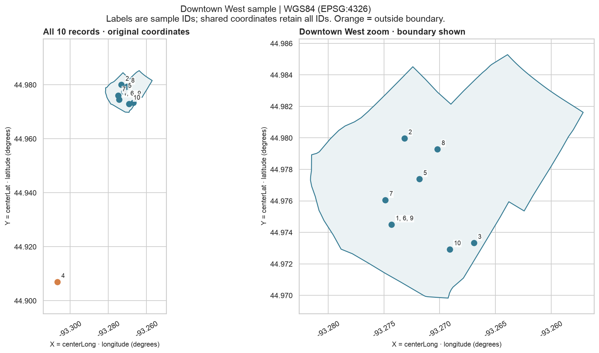

# Downtown West: ten coordinate examples

Select the first ten rows labeled `Downtown West`, ordered by `OBJECTID`. This is a reproducible convenience sample, not a representative sample.

**X = `centerLong` (longitude); Y = `centerLat` (latitude).** The existing degree values are assigned **WGS84 / EPSG:4326** without converting to meters or using the CSV's separate `X`/`Y` columns. This assignment follows the requested interpretation; it does not independently establish the source datum.

[Interactive map](outputs/downtown_west_coordinate_sample.html) · [CSV table](outputs/downtown_west_coordinate_sample.csv) · [WGS84 GeoJSON](outputs/downtown_west_coordinate_sample.geojson)

| Sample ID | Case number | Recorded neighborhood | Longitude (X) | Latitude (Y) | Inside boundary? |
|---|---|---|---:|---:|---|
| 1 | MP202637231 | Downtown West | -93.27432 | 44.97450 | Yes |
| 2 | MP202637815 | Downtown West | -93.27317 | 44.97997 | Yes |
| 3 | MP202638113 | Downtown West | -93.26693 | 44.97333 | Yes |
| 4 | MP202638847 | Downtown West | -93.30675 | 44.90693 | No |
| 5 | MP202638974 | Downtown West | -93.27183 | 44.97738 | Yes |
| 6 | MP202639064 | Downtown West | -93.27432 | 44.97450 | Yes |
| 7 | MP202639972 | Downtown West | -93.27488 | 44.97606 | Yes |
| 8 | MP2026702032 | Downtown West | -93.27020 | 44.97928 | Yes |
| 9 | MP2026702047 | Downtown West | -93.27432 | 44.97450 | Yes |
| 10 | MP2026702050 | Downtown West | -93.26909 | 44.97292 | Yes |

**What the sample reveals:** ten records occupy 8 distinct coordinate pairs. Shared locations are not moved or jittered; their labels list every sample ID. **1 record is outside the downloaded Downtown West boundary**, despite its recorded neighborhood label. The orange point retains its original coordinates and neighborhood; neither is corrected or excluded. The map alone cannot establish whether the coordinate or neighborhood label is wrong. The zoom panel shows the downtown cluster; the overview includes every sampled point.

The boundary check uses the city's cached neighborhood polygon, including its edges (`covers`). It is a geographic consistency check, not independent verification of the exact incident site. Folium accepts `[latitude, longitude]` for markers; GeoJSON and the static plot use X/Y = longitude/latitude.

Run `.venv/bin/python analysis/map_coordinate_sample.py` to regenerate. No records in the input CSV are changed.
