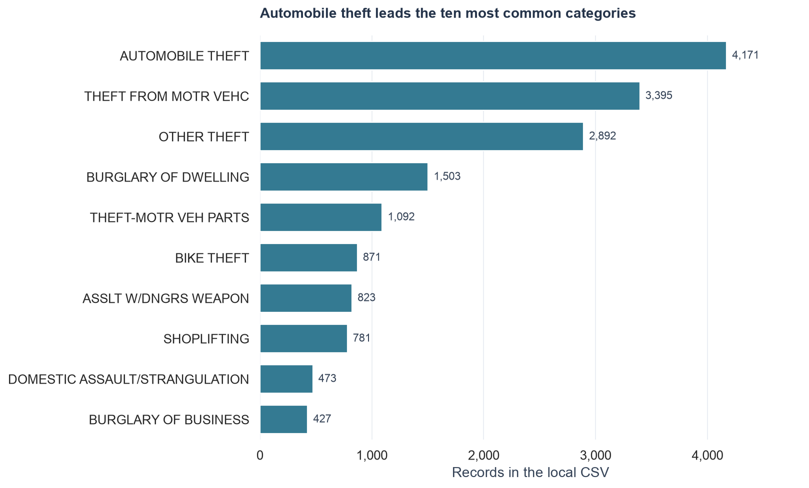
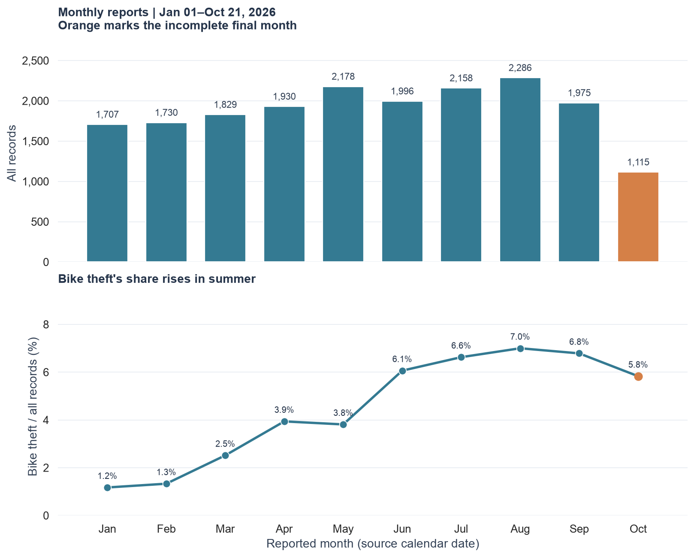
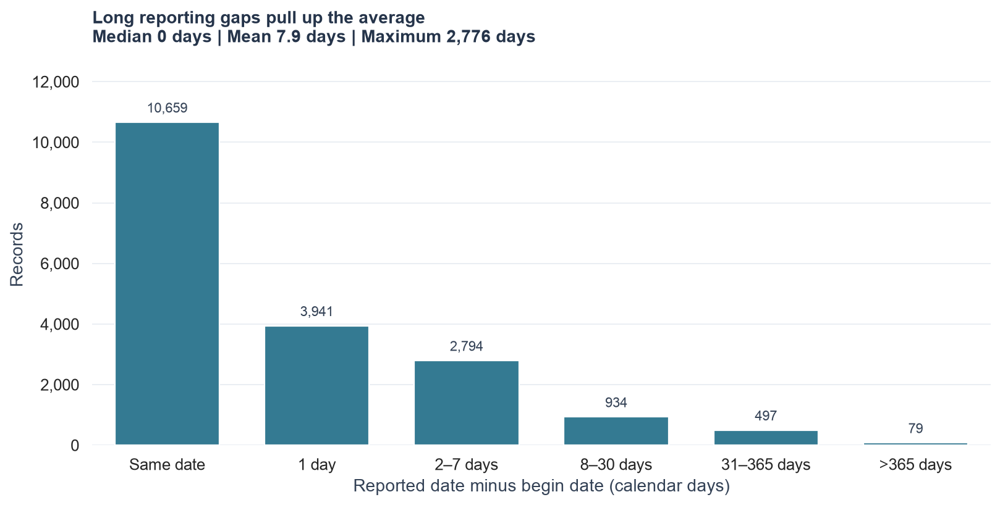
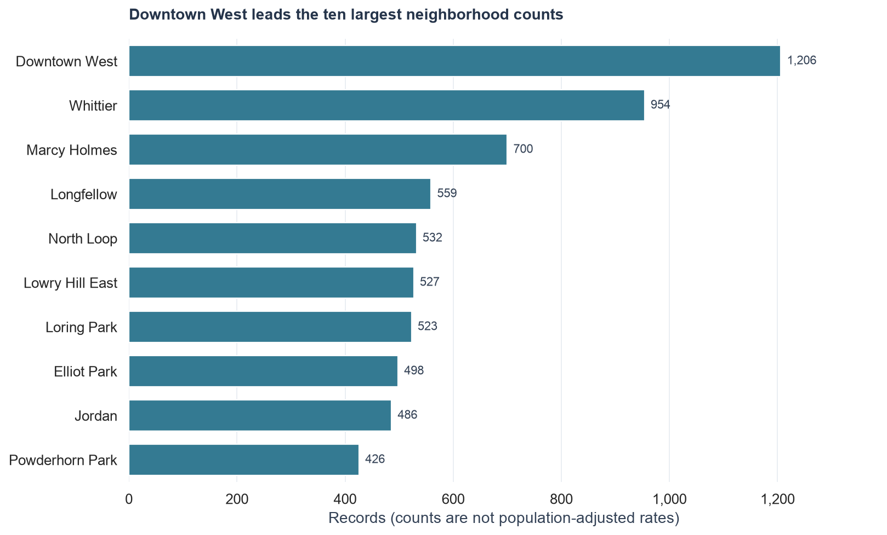

# Minneapolis police incidents: a first look

The local CSV contains **18,904 records and 23 columns**, covering reports from **January 01 to October 21, 2026**. It has 47 offense descriptions and 87 named neighborhoods, with 0 repeated case numbers.

Variables include offense categories, dates, neighborhoods, and numeric coordinates. Identifiers and codes are treated as text; dates are parsed explicitly. [Column details](outputs/column_summary.csv) · [Date checks](outputs/date_summary.csv)

## Missing values: what we do and why

Pandas recognizes empty cells and standard missing markers such as `NA` when reading the CSV. We **retain all 18,904 rows** and never guess missing codes or locations.

| Field | Missing | Treatment |
|---|---:|---|
| `centergbsid` | 18,904 (100%) | Leave empty and do not use it in summaries. Dropping rows because this field is missing would erase the dataset. |
| `UCRCode` | 109 (0.58%) | Leave missing; category charts use the available `description` instead. |
| `neighborhood` | 11 (0.06%) | Count as **Unknown** in the neighborhood table; it falls outside the chart's top ten. |

All other fields have no detected missing values. `Unknown` is a grouping label, not an inferred neighborhood. No blanket `dropna()` or imputation is used.

Dates that cannot be parsed become missing dates and are counted in the [date checks](outputs/date_summary.csv). Monthly summaries require a valid reported date; reporting gaps require both reported and begin dates. Means, medians, and gap percentages use valid date pairs only. In this file, **0 rows are excluded from monthly counts and 0 from gap calculations**.

## Four patterns

**1. A few offense categories dominate.** Automobile theft accounts for **4,171 records (22.1%)**. The three largest categories together make up **55.3%** of records.

**2. Bike theft increases sharply in summer.** January has **20 reports**, compared with **160 in August**. Its share of all reports grows from **1.17% to 7.00%**, so this exceeds the change in overall reporting volume. This pattern does not establish its cause.

**3. Reporting gaps have a long tail.** The median is **0 days**, but the mean is **7.86 days**. **576 reports (3.05%)** have gaps over 30 days. These are calendar-date differences; zero days means the same date, not immediate reporting. **342 incidents began before 2026**.

Date-order check: **0 negative gaps**. The empty category is omitted from the chart.

**4. Neighborhood counts differ.** Downtown West has **1,206 records**, followed by Whittier with **954**. Counts do not measure resident risk or adjust for population and visitors.

## Read these charts carefully

- **October is incomplete:** coverage stops on October 21, so its lower count is not a comparable monthly decline. Month lengths also differ.
- Dates retain their source calendar dates; no local hour-of-day analysis is attempted.
- Results describe this local file, which differs from the changing live API.

To regenerate the report, tables, and Seaborn charts: `.venv/bin/python analysis/explore_police.py`. Dependencies are in [requirements.txt](requirements.txt).

For neighborhood maps and incident-type heatmaps, see [mapping summary](mapping_summary.md).
