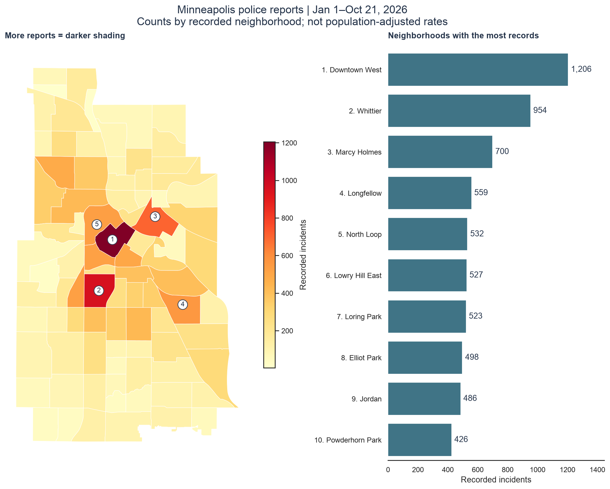
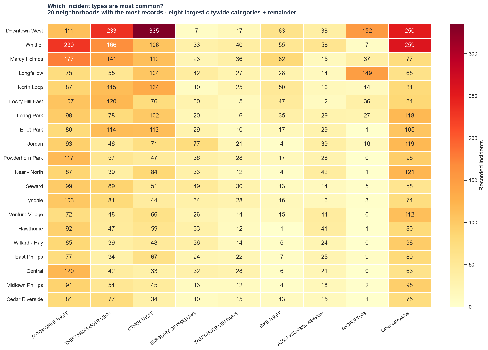

# Neighborhood incident maps

[Open the interactive map](outputs/neighborhood_incidents_interactive.html). Hover over a neighborhood for its total and leading incident type. Use the layer controls to turn off neighborhood totals and turn on **Point density** for a smoothed heatmap. The HTML needs internet access for map tiles and JavaScript libraries; PNGs below work offline.

## Where are the most incidents recorded?

Darker areas have more records. Numbered markers identify the five neighborhoods at the top of the ranking.

| Neighborhood | All records | Most common description | Leading count (share) |
|---|---:|---|---:|
| Downtown West | 1,206 | OTHER THEFT | 335 (27.8%) |
| Whittier | 954 | AUTOMOBILE THEFT | 230 (24.1%) |
| Marcy Holmes | 700 | AUTOMOBILE THEFT | 177 (25.3%) |
| Longfellow | 559 | SHOPLIFTING | 149 (26.7%) |
| North Loop | 532 | OTHER THEFT | 134 (25.2%) |

## Which types are most common within neighborhoods?

Rows are the 20 neighborhoods with the most records, ordered by total. Columns show the eight largest citywide descriptions plus **Other categories**, which combines all remaining descriptions. Cell numbers and colors show counts; row totals include every description. The combined Other column should not be interpreted as a single incident type. The map hover and [full neighborhood summary](outputs/neighborhood_map_summary.csv) identify each neighborhood's actual leading description across all categories, including ties.

## How the mapping works

- Join CSV `neighborhood` to `BDNAME` in the [City of Minneapolis boundary layer](https://services.arcgis.com/afSMGVsC7QlRK1kZ/arcgis/rest/services/Minneapolis_Neighborhoods/FeatureServer/0). All **87 named neighborhoods match exactly**; no fuzzy matching or geocoding is used.
- Map **18,893 records**. The **11 records without a neighborhood** remain in the original data and the exploration's Unknown group; they are excluded from neighborhood maps and the density layer. Missing `UCRCode` and `centergbsid` do not exclude records.
- GeoJSON boundaries use longitude/latitude (EPSG:4326). The static map is projected to NAD83 / UTM zone 15N (EPSG:26915). The density layer uses `centerLat`/`centerLong`; repeated locations are weighted by their record counts. All 18,893 mapped records have valid coordinate ranges. Public locations are approximate, and density colors are relative concentrations, not exact counts or geographic risk.
- These maps use the CSV's **recorded neighborhood**, not a new point-in-polygon assignment. Counts are police records, not all incidents or population-adjusted rates. Coverage is January 1–October 21, 2026.

## Checks and reuse

All neighborhood totals were independently recomputed with Python's `Counter` and match the plotted totals. Leading-type counts for the five largest neighborhoods also match. **18,893 mapped + 11 unknown = 18,904 original records**; no join duplicated rows. See [checks](outputs/mapping_checks.json) and [all neighborhood/type counts](outputs/neighborhood_offense_counts.csv).

Run `.venv/bin/python analysis/map_police.py` to rebuild from the cached boundary file. Boundary source and retrieval details are saved under `data/`.
