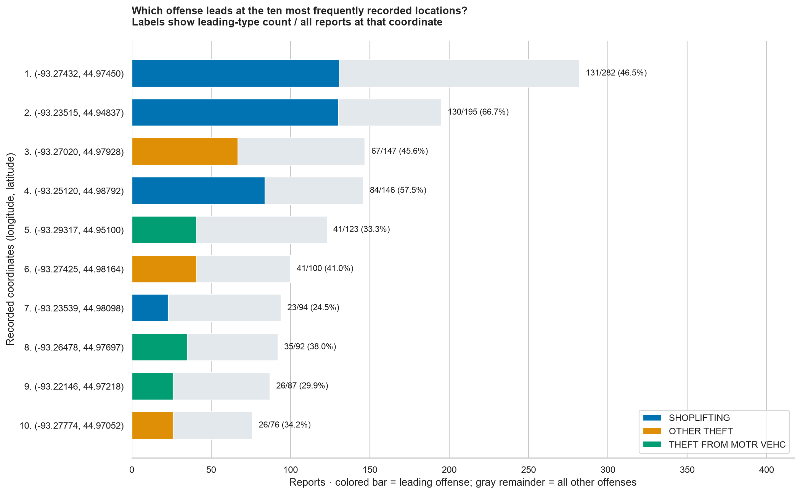

# Offense types at repeated coordinates

**Question:** Among the ten coordinate pairs with the most police reports in the local CSV, which offense description is most common at each pair?

Group `centerLong` and `centerLat` by exact equality, without rounding. A repeated location has at least two records. Rank locations by total reports, then compare all offense descriptions within each location. Ties are listed together; percentages refer to each tied type separately.

## Results

There are **4,485 distinct coordinate pairs**, including **2,205 repeated pairs** containing **16,624 reports (87.9% of the file)**. The ten largest locations contain 1,342 reports.

| Longitude, latitude | Total reports | Leading description | Leading count (share) |
|---|---:|---|---:|
| -93.27432, 44.97450 | 282 | SHOPLIFTING | 131 (46.5%) |
| -93.23515, 44.94837 | 195 | SHOPLIFTING | 130 (66.7%) |
| -93.27020, 44.97928 | 147 | OTHER THEFT | 67 (45.6%) |
| -93.25120, 44.98792 | 146 | SHOPLIFTING | 84 (57.5%) |
| -93.29317, 44.95100 | 123 | THEFT FROM MOTR VEHC | 41 (33.3%) |
| -93.27425, 44.98164 | 100 | OTHER THEFT | 41 (41.0%) |
| -93.23539, 44.98098 | 94 | SHOPLIFTING | 23 (24.5%) |
| -93.26478, 44.97697 | 92 | THEFT FROM MOTR VEHC | 35 (38.0%) |
| -93.22146, 44.97218 | 87 | THEFT FROM MOTR VEHC | 26 (29.9%) |
| -93.27774, 44.97052 | 76 | OTHER THEFT | 26 (34.2%) |

Shoplifting leads at four of these ten locations; other theft and theft from motor vehicles each lead at three. A leading category is the largest category, not necessarily a majority of reports.

## Interpretation and checks

- Exact equality means the same **recorded coordinates**, not proof of the same physical incident site. Public coordinates may be approximate or shared across nearby addresses. This analysis cannot establish why reports cluster there.
- Some coordinate pairs have multiple recorded neighborhood labels. Grouping by coordinates avoids assuming that one neighborhood label is correct; the [full summary](outputs/repeated_location_summary.csv) preserves every neighborhood label and its count.
- Use all records with valid coordinates, including those with missing neighborhood or UCR code. **0 records have missing/invalid coordinate ranges and are excluded.** Missing descriptions would be counted as Unknown offense. Dates cover January 1–October 21, 2026; these are counts, not risk estimates or complete-year totals.
- A separate `Counter` calculation reconciles all repeated-location report totals and the top ten leading-category counts. No source values are changed.

[Every repeated location and its leading type](outputs/repeated_location_summary.csv) · [All offense counts by repeated location](outputs/repeated_location_offense_counts.csv)

Run `.venv/bin/python analysis/repeated_locations.py` to regenerate.
