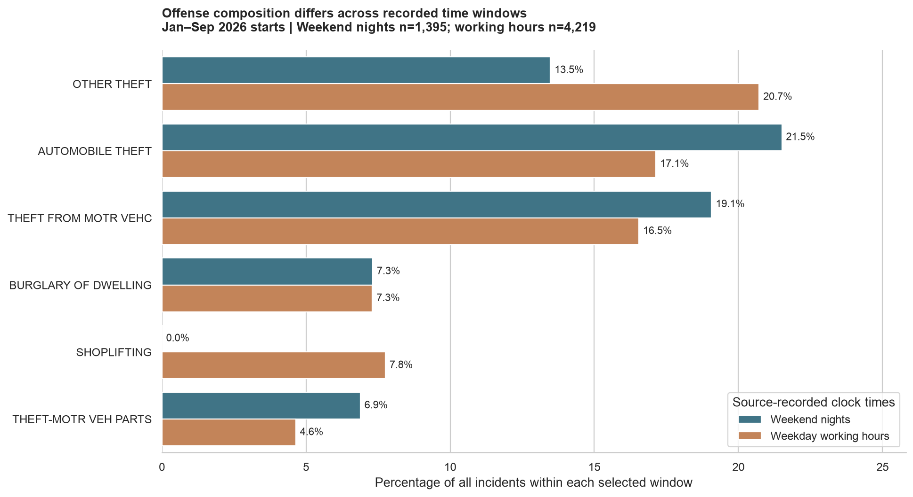

# Weekend nights versus weekday working hours

**Question:** Among incidents with valid recorded start dates and times in January–September 2026, how do the most common offense descriptions and their percentage shares differ between the two windows?

**Agreed assumption:** use the calendar date in `beginDate` and HHMM in `beginTime` **as recorded, without time-zone conversion**. These are recorded-clock comparisons, not confirmed Minneapolis local-time comparisons.

## Method

- Keep start dates January 1–September 30. Validate HHMM (hours 00–23, minutes 00–59); `30` means 00:30.
- Weekend nights: Friday 23:00–Saturday 04:00 and Saturday 23:00–Sunday 04:00. Working hours: Monday–Friday 09:00–17:00. Include starts and exclude endpoints.
- Count every description and divide by **all incidents in its window**. Keep missing descriptions as Unknown. Neighborhood, coordinate, and UCR-code missingness does not exclude records.
- Plot the union of each window's top five descriptions, including ties at fifth place. Reuse the exploration's Seaborn style; the [earlier maps](mapping_summary.md) provide geographic context without requiring another spatial join.

## Results

**17,566 eligible records:** 1,395 weekend nights, 4,219 working hours, and 11,952 outside both windows. Of 18,904 source rows, 0 have invalid/missing dates, 1,338 have dates outside January–September, and 0 have invalid/missing times within the period. [Audit](outputs/time_window_filter_audit.csv)

| Description | Weekend nights (n=1,395) | Working hours (n=4,219) | Night minus work (percentage points) |
|---|---:|---:|---:|
| OTHER THEFT | 188 (13.5%) | 874 (20.7%) | -7.2 |
| AUTOMOBILE THEFT | 300 (21.5%) | 723 (17.1%) | +4.4 |
| THEFT FROM MOTR VEHC | 266 (19.1%) | 698 (16.5%) | +2.5 |
| BURGLARY OF DWELLING | 102 (7.3%) | 308 (7.3%) | +0.0 |
| SHOPLIFTING | 0 (0.0%) | 327 (7.8%) | -7.8 |
| THEFT-MOTR VEH PARTS | 96 (6.9%) | 196 (4.6%) | +2.2 |

**Leading descriptions:** AUTOMOBILE THEFT at night; OTHER THEFT during working hours. Displayed categories need not total 100%; denominators include all categories. [Complete comparison](outputs/time_window_offense_comparison.csv)

## Midnight sensitivity

Keep `0000` as valid midnight in the main analysis. Excluding **216 midnight entries (15.5% of night records)** leaves **1,179** night records; working hours are unchanged. Midnight could reflect an exact, rounded, or default value—the CSV does not distinguish these.

| Description | Main night share | Excluding 0000 |
|---|---:|---:|
| OTHER THEFT | 13.5% | 13.1% |
| AUTOMOBILE THEFT | 21.5% | 20.8% |
| THEFT FROM MOTR VEHC | 19.1% | 18.7% |
| BURGLARY OF DWELLING | 7.3% | 6.8% |
| SHOPLIFTING | 0.0% | 0.0% |
| THEFT-MOTR VEH PARTS | 6.9% | 5.5% |
| ASSLT W/DNGRS WEAPON | 6.6% | 7.7% |

**Nighttime top-five changes:** entered: ASSLT W/DNGRS WEAPON; left: THEFT-MOTR VEH PARTS. [All sensitivity counts, shares, and ranks](outputs/time_window_midnight_sensitivity.csv)

## Verification and interpretation

Record accounting and all-description share checks pass. An independent CSV/date-time algorithm matches every offense count and both denominators. **8 identified source-record checks** confirm overnight and endpoint handling; see [Section 7.3 verification evidence](time_window_verification.md).

The verification checks calculations **under the recorded-clock assumption**; it does not establish the source time zone or time accuracy. These results describe offense composition, not overall peak hours, per-hour rates, or causes. The snapshot's reporting coverage ends October 21, so delayed and unreported incidents can affect completeness.

Run `.venv/bin/python analysis/compare_time_windows.py` to rebuild. [Per-record assignments](outputs/time_window_assignments.csv) include original case numbers, start values, and the assigned group or exclusion reason.
